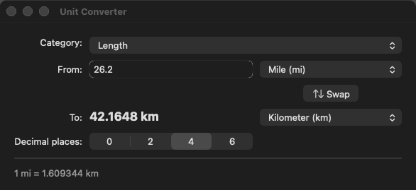

# loup-macos-unit-converter — a unit converter in Loup

A native macOS application written in Loup on top of the
[`appkit`](https://github.com/myronccai/loup-macos-appkit) library. Pick a
category and two units, type a value, and the converted value follows every
keystroke.



## Getting started

### Requirements

- macOS on Apple silicon or Intel, with the Xcode Command Line Tools
  (`xcode-select --install`).
- A Loup toolchain of version **newer than 1.27.0**, with `loup`, `loup-build`,
  `loup-llvm`, `loup-test` and `loup-bootstrap` on `PATH`. The app needs
  fixes made after the 1.27.0 release ([Loup releases](https://github.com/code-craft-ai-company/loup-releases/releases)).
- The [`loup-macos-appkit`](https://github.com/myronccai/loup-macos-appkit)
  library, checked out next to this repository: the manifest
  (`loup-macos-unit-converter.lppkg`) depends on it as
  `appkit = { path = "../loup-macos-appkit" }`.

### Get the code

Clone both repositories into the same directory:

```sh
git clone https://github.com/myronccai/loup-macos-appkit
git clone https://github.com/myronccai/loup-macos-unit-converter
cd loup-macos-unit-converter
```

### Build, run, test and self-test

From inside `loup-macos-unit-converter`:

```sh
loup build                                  # build → ./loup-macos-unit-converter
./loup-macos-unit-converter                 # run the application
loup test --strict src                      # the logic tests
./loup-macos-unit-converter --self-test     # drive the window, print what it shows, quit
bash ../loup-macos-appkit/run_all.sh loup-macos-unit-converter   # the full gate
```

The gate builds the app with both toolchains, runs `loup test` and checks
both builds' `--self-test` output against [`selftest.out`](selftest.out);
[Build, run, test](#build-run-test) below has the details.

If linking fails with `tapi error … unknown architecture`, point `SDKROOT`
at an older SDK, for example:

```sh
export SDKROOT=/Library/Developer/CommandLineTools/SDKs/MacOSX26.5.sdk
```

## What it does

- **Category** pop-up: Length, Mass, Temperature, Volume, Speed, Data size.
  Choosing one fills the **From** and **To** pop-ups with its units and picks
  a sensible pair (km → mi, kg → lb, °C → °F, L → gal, km/h → mph,
  MB → MiB).
- **From** field: the value to convert, converted live as you type. It
  accepts a sign, a decimal point, an exponent and comma thousands
  separators (`-40`, `1,000,000`, `2.5e-3`). A comma counts only before a
  group of exactly three digits, and only after a first group that does not
  start with 0, so a decimal comma such as `1,5` (or `12,34`, `1,2,3`,
  `0,500`) shows *Not a number* instead of being read as 15 or 500. Other
  text that is not a number shows *Not a number*, a number beyond a double's
  range (`1e400`) shows *Too large*, and an empty field shows *—*.
- **To**: the result in bold, in the To unit (`7.77 mi`). It is selectable.
  A long result is drawn in a smaller font (down to 10 pt) so the whole
  number and its unit always fit (`1,897,797.257524 fl oz` at 6 places).
- **Swap** (⇅) exchanges the From and To units; the typed value stays.
- **Decimal places**: a segmented control, 0, 2, 4 or 6 places, rounded half
  away from zero, thousands grouped (`26,400.00 ft`). Scientific notation is
  used only at the two ends, and the large end does not depend on the
  precision:
  - a result of 10^15 or more (`8.00e+15 bit`); below that the result stays
    in fixed point at every precision (`8,000,000,000.000000 bit`);
  - a non-zero result that would round to zero at the chosen precision,
    that is below half the last place shown (1 mm in nautical miles at 2
    places is `5.40e-7 nmi`, not `0.00 nmi`; 0.1 ft/s in km/h at 0 places is
    `1e-1 km/h`). A result that rounds to a non-zero last place stays in
    fixed point (0.5 ft/s is `1 km/h` at 0 places), and a result that is
    really zero stays `0.00`.
- Under the line, the **rate**. For a plain factor it is what one From unit
  is in the To unit (`1 km = 0.621371 mi`); when that is a tiny fraction it
  is turned round so it says something (`1 TiB = 8,796,093,022,208 bit`
  instead of `1 bit = 0 TiB`). For two temperature scales with different
  zero points a "1 °C = 33.8 °F" line would read like a scale factor, so the
  rate line is the formula instead: `°F = °C × 1.8 + 32`,
  `°C = (°F − 32) ÷ 1.8`, `°C = K − 273.15`.
- **Temperature is affine**, not a plain factor: Celsius, Fahrenheit, Kelvin
  and Rankine convert through kelvin with an offset, so 0 °C is 32 °F and
  −40 is the same in both. A temperature below absolute zero shows
  *Below absolute zero*.
- Menus: **Convert ▸ Swap Units** (⇧⌘S) and **Convert ▸ Copy Result** (⇧⌘C,
  the result as shown), and a **Category** menu (⌘1 … ⌘6) whose check mark
  follows the current category. The App, Edit and Window menus are the
  standard ones; ⌘Q or closing the window quits. The window has a fixed
  size: the form's columns have fixed widths, so more room would only be
  empty space.

### The units

| Category | Base | Units |
|---|---|---|
| Length | metre | mm, cm, m, km, in, ft, yd, mi, nmi |
| Mass | kilogram | mg, g, kg, t, oz, lb, st |
| Temperature | kelvin | °C, °F, K, °R |
| Volume | litre | mL, L, m³, tsp, tbsp, fl oz, cup, pt, qt, gal (US), imp gal |
| Speed | metre per second | m/s, km/h, mph, ft/s, kn |
| Data size | byte | bit, B, kB, MB, GB, TB, KiB, MiB, GiB, TiB |

Every unit maps to its base as `base = (value + offset) × factor` and back as
`value = base / factor − offset`; only the temperature scales have an
offset (Celsius 273.15, Fahrenheit 459.67). Two plain-factor units convert
by the ratio of their factors, so a tiny value (`1e-320` mm) is never pushed
through an even tinier base-unit value that a double cannot hold.

## Build, run, test

Needs macOS, the Xcode Command Line Tools and the Loup toolchain, newer than
1.27.0 (`loup`, `loup-build`, `loup-llvm`, `loup-test`, `loup-bootstrap`), on
`PATH`, and `loup-macos-appkit` checked out next to this repository (see
[Getting started](#getting-started)).

```sh
cd loup-macos-unit-converter
loup build                                  # self-hosted toolchain → ./loup-macos-unit-converter
loup-bootstrap build --target native        # or the Stage0 (Rust) toolchain
./loup-macos-unit-converter                      # the application

loup test --strict src                      # the logic tests (numtext, units)
./loup-macos-unit-converter --self-test          # drives the window, prints, quits
./loup-macos-unit-converter --self-test out.png  # … and writes a snapshot of the window
```

`--self-test` is invisible (no Dock icon, no focus, a transparent window).
It uses the window the way a person would — selects the field's text and
types over it one keystroke at a time, picks categories and units from the
pop-ups' menus, clicks Swap, chooses decimal places, presses ⌘2, chooses the
Category and Convert menu items from the menu bar (the clipboard is saved and
restored around Copy Result) — and after each step prints what the controls
show: category, units, typed text, precision, result and rate. It also checks
the edge cases: a decimal comma, a long result (and that it fits its
column), results under one at 0 places, a large result at 6 places, a tiny
result and a number too large for a double. Its output must equal
[`selftest.out`](selftest.out) for both builds. The gate for all the macOS
examples, `run_all.sh` in
[`loup-macos-appkit`](https://github.com/myronccai/loup-macos-appkit), checks
that:

```sh
bash ../loup-macos-appkit/run_all.sh loup-macos-unit-converter                # both builds, self-tests, loup test
bash ../loup-macos-appkit/run_all.sh --screenshots loup-macos-unit-converter  # … and refreshes screenshot.png
```

## Structure

| File | Mode | What it is |
|---|---|---|
| `src/main.lphc` | `host.native` | The window (a grid in a stack) and its handlers (class `Ui`), the menus and the `--self-test` driver. The controls are the state: every handler reads them back and asks the model for the result and rate text. |
| `src/units.loup` | `host.dual` | The unit tables, the default pair of each category (looked up by symbol), `convert` (by the factors' ratio for plain units), the precision choices, and the result and rate text (formulas for affine pairs). |
| `src/numtext.loup` | `host.dual` | Reading typed numbers (strict thousands groups, overflow detection) and writing them for display (rounding, grouping, scientific notation at both ends), digit by digit so every build prints the same text. |
| `src/units_test.lpscr` | `host.scripted` | Tables and defaults, linear and temperature conversions, round trips across every unit pair, result text and rounding (decimal commas, tiny, subnormal and too-large results, 0 places), the rate line and the temperature formulas. |
| `src/numtext_test.lpscr` | `host.scripted` | Parsing (signs, grouping, misplaced commas and leading-zero groups, exponents, overflow, rejects), fixed and scientific formatting, the rounds-to-zero fallback, rounding, round trips. |
| `selftest.out` | | The expected `--self-test` output. |
| `screenshot.png` | | Written by `../loup-macos-appkit/run_all.sh --screenshots`. |

### appkit modules and controls used

The modules are those of the
[`loup-macos-appkit`](https://github.com/myronccai/loup-macos-appkit) library.

| Module | Used for |
|---|---|
| `appkit.app` | `appInit` (App/Edit/Window menus), `Window` (`setContent`, `setResizable(false)`, `fitToContent`, `sendKey`, `snapshot`), `Menu` / `MenuItem` / `addMenu` (Convert and Category menus; `menuBarMenu`, `itemAt`, `itemWithTitle`, `setChecked` / `checked`, `perform`), `MOD_COMMAND`, `after`, `isSelfTest`, `run`, `quit` |
| `appkit.controls` | `PopUpButton` (category, From, To; `choose` in the self-test), `TextField` (the value: `onChange`; `selectAll` / `typeKey` / `deleteBackward` in the self-test), `Label` (form labels with `TEXT_RIGHT`, the bold result with `setShrinkToFit` and `textWidth`, the rate in `systemColor(COLOR_SECONDARY_LABEL)`), `Button` with an SF Symbol (Swap), `SegmentedControl` (decimal places) |
| `appkit.layout` | `GridView` (the form: right-aligned labels, merged category cell, baseline-aligned rows, `setCellXAlignment` to center the Swap button), `VStack` with a separator |
| `appkit.dialogs` | `copyText` (Copy Result); `saveClipboard` / `pasteText` / `restoreClipboard` in the self-test |

The app sends no raw Objective-C messages; everything goes through these
proxies.

## Toolchain notes

The app needs no toolchain workarounds. Earlier versions had three, each
for a native-driver bug that is now fixed:

- the `Ui` object was pushed into its module-level list as a temporary (an
  object bound with `let` and pushed into a module-level list was lost);
- grid rows were built by pushing (a mixed-subclass list literal passed to
  a method);
- the `Ui` lived in a module-level list and the handlers were module
  functions that fetched it, so that no closure captured an object (a
  native build read a captured object's fields by bare name across the
  program). Now the handlers are `Ui` methods, and the closures in `main`
  and `buildMenus` capture the `Ui` and call them.

A virtual call on a `list[View]` element inside a callee module (Stage0
native bound it to the base class's method) is fixed as well; it never
affected the app, since `GridView.addRow` only reads each cell's `handle`.

## License

MIT; see [LICENSE](LICENSE). Built on the
[`loup-macos-appkit`](https://github.com/myronccai/loup-macos-appkit) library.
